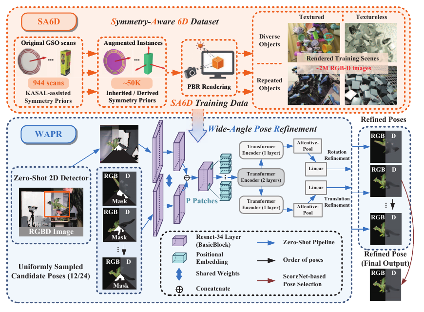
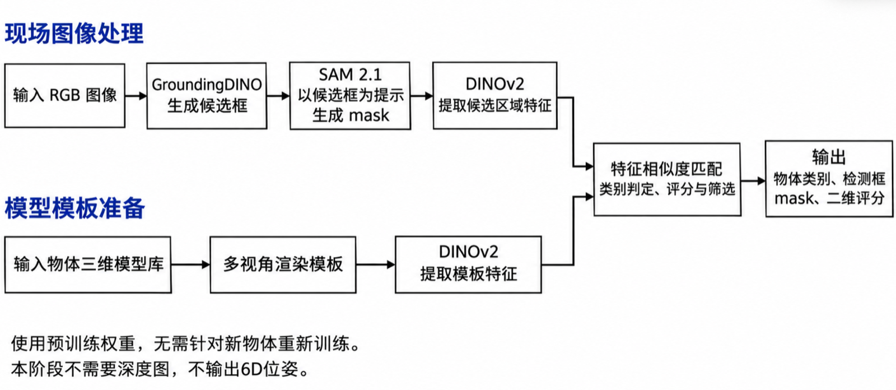
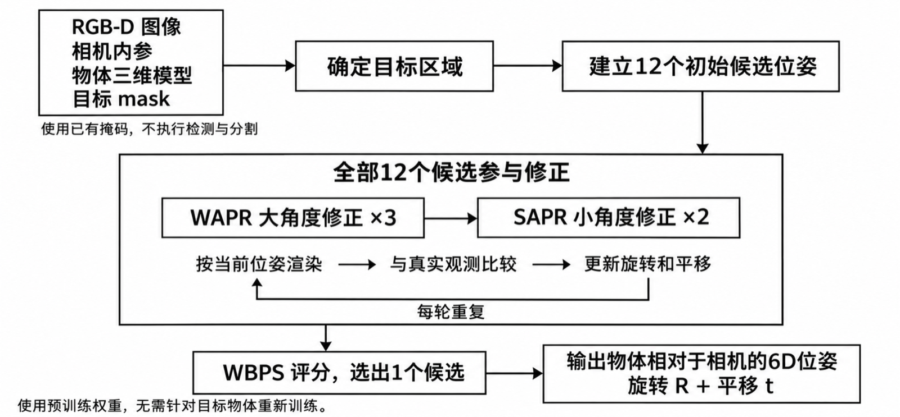
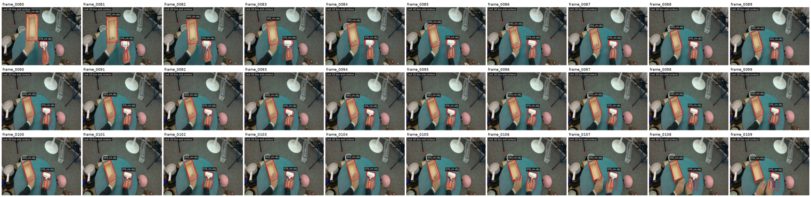
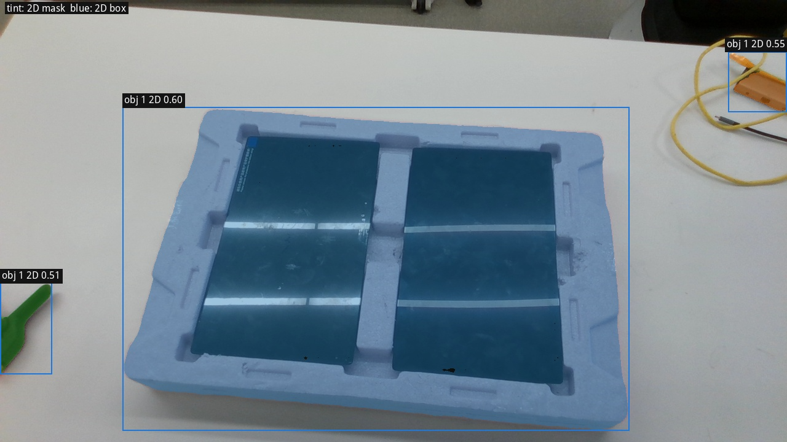
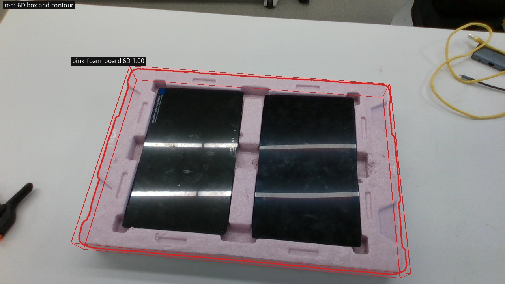
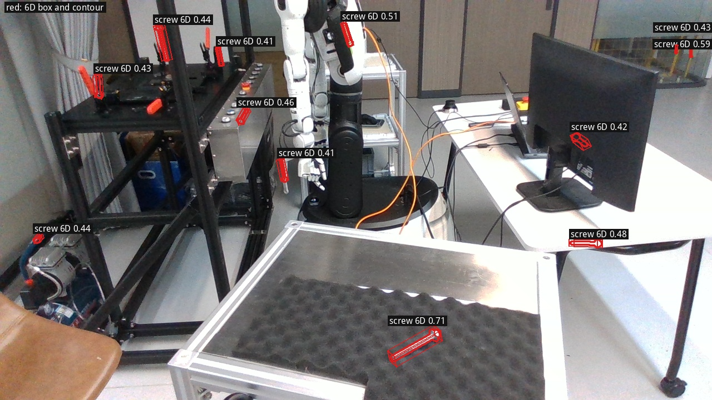
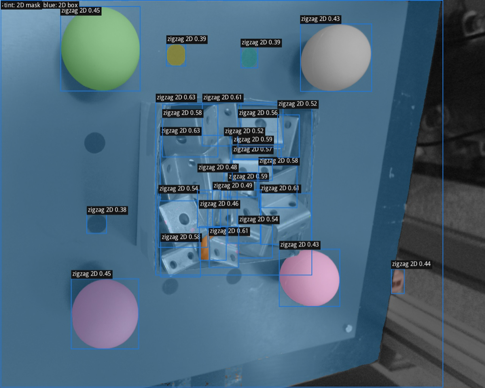
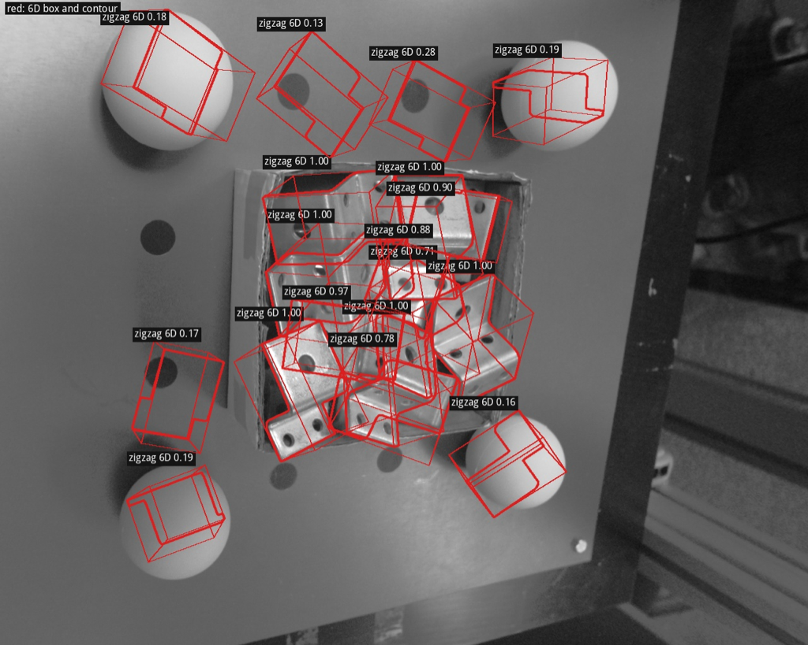

最近，我在做 WAPR 的工程实践。它是一种面向未见物体的 6D 位姿修正方法：给定 RGB-D 图像、相机内参和物体三维模型，估计物体相对于相机的三维位置与朝向。在工业场景里，这正好对应分割与位姿估计两个环节的组合需求。

我希望通过这次实践，弄清楚它怎样接入真实采集的数据，以及从官方示例走向工业场景时，还需要解决哪些问题。实验从环境搭建开始，逐步覆盖了检测分割、单物体与多物体位姿估计、连续帧跟踪，最后扩展到 166 个真实物体的批量精度测试，以及 Orin 边缘设备上的耗时对比。

目前，已有三维模型条件下的各条处理流程都已跑通。自采托盘数据能够得到基本合理的投影结果，复杂背景下的误检、重复预测和部分物体的姿态歧义，也在测试中逐一暴露了出来。

## WAPR 在解决什么问题

6D 位姿包含三维平移和三维旋转。对于机器人抓取这类任务，只知道物体在图像中的位置还不够，还需要知道它在相机坐标系中的空间位置和朝向。

传统位姿估计方法通常需要针对每个物体训练模型，换一个物体就要重新标注、重新训练。WAPR 走的是另一条路：模型在大量合成数据上训练一次，推理时直接用于训练阶段从未见过的物体，只要提供该物体的三维模型即可。

它的整体框架分为训练数据构建和位姿修正两部分。训练数据以 GSO 数据集中约 944 个物体扫描为基础，借助对称性先验扩增到约 5 万个物体实例，再通过物理渲染生成约 200 万张 RGB-D 图像，训练场景覆盖有纹理、无纹理和同类物体重复摆放等情况。构建训练样本时，程序在参考位姿上加入旋转和平移扰动——旋转扰动最高约 90°——让网络学习把有偏差的候选位姿逐步修正到正确值。

<figure>

<figcaption>WAPR 整体框架：上半部分是 SA6D 对称感知训练数据的构建流程，下半部分是比较真实观测与渲染观测、逐步修正位姿的网络结构。</figcaption>
</figure>

两个设计值得单独一说。

**对称物体处理。** 对称物体可能有多个外观完全相同的有效姿态，比如四个侧面一致的无纹理方柱，绕对称轴旋转 90° 后与原姿态等价。如果训练时强行区分这些等价姿态，相似的图像就会对应互相矛盾的修正目标。SA6D 在构建训练数据时利用对称性先验统一等价姿态的训练目标，减少这种监督冲突——它不是把任意偏差都当作正确，而是只对符合物体对称关系的姿态做一致处理。

**角度平衡损失。** 大角度偏差下，候选渲染与真实观测可能只有少量共同可见区域，部分样本根本提供不出有效的修正依据。论文根据旋转预测误差调整样本权重，提高可学习样本的贡献，压低对应信息不足样本的影响，让大角度修正的训练更稳定。

大角度修正能力带来的直接好处是初始候选可以更少：论文的快速设置用正四面体的 4 个观察方向、每个方向 3 种面内旋转，共 12 个初始位姿，先对全部候选修正两轮并评分，再保留最高分的 4 个继续修正。我使用的官方仓库默认流程略有不同：12 个候选全部执行 3 次 WAPR 修正和 2 次 SAPR 修正，最后由 WBPS 评分选出结果，没有中途缩减候选。方法本身的介绍可以参考 [WAPR 官方仓库](https://github.com/WangYuLin-SEU/WAPR)。

## 两条核心流程

整个系统可以拆成两条流水线。

**检测与分割**只使用 RGB 图像：先由 GroundingDINO 生成候选框，再把候选框作为位置提示交给 SAM 生成掩码，同时从多个视角渲染物体的三维模型建立模板库；随后用 DINOv2 分别提取候选区域和模板的特征，通过相似度匹配确定类别，并进行评分与筛选。这一阶段不需要深度图，也不输出位姿。

<figure>

<figcaption>检测与分割流程：现场图像与模型模板两条支线分别提取特征，汇入相似度匹配后输出类别、检测框、掩码和二维评分。</figcaption>
</figure>

**6D 位姿估计**以 RGB-D 图像、相机内参、物体三维模型和目标掩码为输入：掩码确定目标区域后，建立 12 个初始候选位姿，每一轮都按当前位姿渲染模型、与真实观测比较、预测旋转和平移的修正量，多轮迭代后由 WBPS 评分选出最终结果。推理直接使用预训练权重，无需针对目标物体重新训练，但必须提供对应的三维模型。

<figure>

<figcaption>位姿估计流程：全部 12 个候选参与修正，每轮重复"渲染—比较—更新"，最后由 WBPS 评分选出 1 个结果。</figcaption>
</figure>

## 在 8 GB 显存上跑通环境

我的实验环境是 Ubuntu 22.04，RTX 4060 Laptop GPU（8 GB 显存），CUDA Toolkit 12.8。用 conda 建了独立的 Python 3.10 环境，安装 PyTorch 2.7.1 和项目依赖后，下载官方预训练权重，再把四份权重转换成 TensorRT 推理引擎。

显存限制很快影响了配置选择。在多物体实验中，默认的检测前端直接把显存打满，我把 DINOv2 从 ViT-L/14 换成 ViT-S/14、GroundingDINO 从 Swin-B 换成 Swin-T，并在需要时把位姿估计切换到 PyTorch 后端：

```sh
WAPR_BACKEND=torch \
PYTORCH_CUDA_ALLOC_CONF=expandable_segments:True \
python examples/04_6d_localization.py
```

单帧 RGB-D 的物体重建实验（不提供模型、由图像直接生成模型）则始终过不了显存这一关，暂时没有完成验证。不同实验实际采用的后端和模型规模并不相同，因此后文记录耗时时，我都保留了当次的配置条件。

这个阶段主要解决流程是否可运行的问题：检测框和掩码能否生成，位姿矩阵能否输出，模型投影能否落到对应物体附近。

## 官方样例上的实验

**检测与分割。** 用 LM-O 场景 2 第 307 帧和包含 8 类物体的模型库做测试，程序产生 79 个候选区域，匹配筛选后保留 63 条结果，预热后的单帧处理耗时约 **1.317 s**。结果里能看到明显的问题：obj11 和 obj10 类别判断错误，obj1 因被遮挡漏检，obj8 出现重复检测。流程能跑通，但离直接可用还有距离。

**单物体位姿估计。** 打孔器样例在给定掩码的条件下，输出物体坐标系到相机坐标系的变换矩阵，平移向量约为（−0.119，0.091，0.986）m。使用 TensorRT 后端，预热后的位姿估计耗时约 **74.9 ms**，投影可视化正常。

**多类别在线定位。** 不读取预计算检测结果，让程序现场生成检测框和掩码，在 8 类物体、每类一个实例的约束下，38 个候选区域经筛选保留 34 条检测，最终输出 8 个实例的位姿。由于显存不足，这次用了小模型加 PyTorch 的配置：前端约 **0.739 s**，位姿估计约 **9.405 s**。相比读取预计算检测的流程，这一版是对多个候选做完位姿估计后，再按六维评分筛选，而不是先按二维评分每类保留一个。

**连续帧跟踪。** TACO 样例中同时跟踪盒子与滚轮两个目标：首帧用点击点生成掩码并估计初始位姿，之后每一帧都以上一帧位姿为起点渲染模型并修正。在这段 30 帧的序列里，两个目标的三维包围框和模型投影始终跟随物体，没有出现身份交换。后续 29 帧的批量位姿更新平均约 **59 ms／帧**。

<figure>

<figcaption>TACO 序列第 80～109 帧的双目标跟踪结果。两个目标的模型投影随画面变化持续更新，未观察到脱离目标的情况。</figcaption>
</figure>

## 把 RealSense 自采数据接进来

跑通官方样例后，我开始测试自己采集的泡沫托盘数据。输入图像分辨率为 1280 × 720，深度对齐到 RGB，原始深度值乘以 0.001 转换为米，并提供相机内参和对应的托盘三维模型（约 544.7 × 373.6 × 47.1 mm）。

接入时要特别检查图像、深度、掩码和模型之间的对应关系：目标掩码要覆盖正确区域，深度与彩色图要对齐，模型尺度和深度要使用一致的单位，否则后面的位姿修正很难得到可信结果。

检测环节产生了 17 个候选区域，最终保留 3 条结果，单帧耗时约 **0.825 s**。中央托盘被正确框选并生成掩码，但桌面上的工具和线缆也被误匹配为同一类别——模型库里只有托盘一类，任何相似度超过阈值的候选都会被保留。

<figure>

<figcaption>自采托盘的检测输出：中央托盘（0.60）检出正确，左下工具（0.51）和右上线缆（0.55）属于非目标区域的误匹配。</figcaption>
</figure>

在读取已有掩码的单物体实验中，程序成功输出了托盘的位姿矩阵。模型投影与托盘外边缘大致对齐，但右侧边缘仍有偏差。这次使用 TensorRT，预热后的位姿估计耗时约 **86.1 ms**，不包含此前生成掩码的检测分割时间。

<figure>

<figcaption>自采托盘的单物体位姿估计结果。红色轮廓用于检查投影对齐情况；图中的评分不能直接解释为位姿准确率。</figcaption>
</figure>

这组托盘数据没有真实位姿标注，所以当前能确认的是投影对齐的大致情况，还不能据此报告定位准确率。

在单类别、单实例约束的完整流程中，二维筛选后保留了 12 条检测结果，最终通过位姿评分和数量约束选出一个托盘，前端约 **0.681 s**、位姿估计约 **3.422 s**。这次检测端和位姿端均使用 PyTorch，且需要处理多个候选，与前面读取已有掩码、采用 TensorRT 的单目标测试条件不同，不能把两次耗时差异全部归因于检测前端。这一轮让我更明确地看到候选数量的影响：前端提出的候选越多，后续需要渲染、修正和评分的工作就越多。评估系统速度时，需要把目标区域的获得方式和候选规模一起说明。

## 数量未知时 误检与重复预测

不预先指定实例数量的托盘实验中，程序输出了 12 条位姿：多个候选收敛到中央托盘附近（其中 4 条高分结果位置接近、投影重叠），也有一些预测落在工具、线缆和背景区域，六维评分约 0.277～0.455。

加入基于渲染掩码的重复抑制（两条结果渲染掩码 IoU 大于 0.5 时，抑制评分较低的一条）后，这组托盘预测从 **12 条减少到 7 条**。中央托盘附近的重叠预测有所减少，但部分背景误检仍被保留——这些错误结果与托盘投影的重叠较小，不会因为去重而自动消失；剩下的七条输出也不代表场景里真的有七个托盘。

螺丝场景暴露了更明显的问题：去重后，位姿预测只从 **45 条减少到 44 条**，背景误匹配仍然较多。这个结果说明，除了重复抑制，还需要继续改善目标区域的提取，并验证位姿评分的筛选效果。

<figure>

<figcaption>螺丝场景中的部分预测。背景上仍出现了模型投影，后续需要继续检查前端候选与位姿筛选。</figcaption>
</figure>

## 工业零件堆叠场景

更接近实际需求的测试是 ROBI 数据集的 Zigzag 零件：工业相机拍摄的灰度图加深度的堆叠场景，不提供真实掩码、真实位姿或实例数量。

程序产生 30 个候选区域，筛选后保留 28 条检测，其中一条因缺少有效深度被跳过，最终得到 27 条位姿预测；渲染掩码去重后保留 18 条。前端约 **1.027 s**，位姿估计约 **7.432 s**，另有检测和位姿两个阶段的预热分别约 3.5 s 和 22.6 s（不计入处理耗时）。

<figure>

<figcaption>Zigzag 场景的二维检测结果：中央零件堆密集重叠，周围球体等背景区域也出现了候选框。</figcaption>
</figure>

<figure>

<figcaption>六维输出：零件堆上出现了多条评分接近 1 的高分位姿，也有低至 0.13～0.28 的背景误检被保留。</figcaption>
</figure>

从结果看，重复抑制把 27 条预测压缩到 18 条，说明去重流程已生效；但保留结果中仍有低至 0.128～0.276 的低分候选——去重只能处理互相重叠的重复预测，无法排除与其他结果重叠较小的误检。下一步计划比较提高六维评分阈值前后的误检与漏检变化。

## 批量精度测试 把位置与朝向分开看

后续测试扩展到批量数据：真实物体 **166 个、每个 5 帧、共 830 帧**，在已有掩码和三维模型的条件下，笔记本上多数物体的位姿阶段平均耗时约 **0.07～0.08 s**；仿真数据另测了 10 个物体，可以对照仿真真值。

真实数据记录的是相对参考标注的误差，仿真数据对照的是真值，两者需要分别解读。总体规律是：多数物体平移误差在 1～3 mm、朝向误差在几度以内，但朝向误差的分布远比平移不稳定——有些结果位置很接近参考值，旋转误差却很大。

比如绕轴对称的空气清新剂，只看绕对称轴的姿态时误差约 8°；但黑色橡胶件出现 79°、马克杯出现 124.8°、圆底烧瓶出现 140° 的大角度误差。这些情况需要逐个检查：预测是否属于外观等价的对称姿态，是否发生了上下翻转，坐标系和模型原点是否一致。不能仅凭投影轮廓接近就认为完整位姿正确，也不能把所有大角度误差都归因于对称性。仿真测试同样印证了一点：上下对称的物体容易被"倒过来"识别。

## 在 Orin 上重新看时间开销

同一套流程迁移到 Orin 边缘设备后，我补了一组对比测试，同样体现了输入条件的重要性。

| 流程 | 方法与条件 | 耗时 |
|---|---|---|
| 检测分割（自采托盘） | WAPR 检测前端，DINOv2 用 TRT | 完整耗时约 2.578 s |
| 检测分割（同一图像） | YOLO 实例分割，需训练权重 | 完整耗时约 0.299 s |
| 托盘位姿估计 | WAPR，已有掩码，TRT | 预热后约 0.367 s |
| 托盘位姿估计 | WAPR，现场检测 31 个候选 | 前端约 2.582 s，位姿约 5.837 s，合计约 8.535 s |
| 托盘位姿估计 | Fdpose，已有掩码，TRT | 约 9.847 s |

几条记录放在一起看很有意思：WAPR 的零样本检测前端比训练过的 YOLO 慢了近一个数量级，这是"免训练"换来的代价；而在位姿阶段，WAPR 使用已有掩码时只要 0.367 s，明显快于 Fdpose 的 9.847 s，两种方法得到的托盘平移也相当接近（分别约为 (10.63, 82.51, 798.05) mm 和 (7.54, 89.33, 804.98) mm）。

这些记录帮助我区分了单目标位姿修正与完整定位流程的开销。继续做边缘部署时，我会重点检查前端耗时、候选数量，以及不同后端配置下的实际表现。

## 接下来继续做什么

接下来，我准备把工作集中到三个方向：建立更贴近工业场景的分割与位姿验证数据；检查误检、漏检与重复输出之间的关系，验证评分阈值的效果；在一致的输入、后端和计时条件下，继续比较推理耗时与位姿误差。

这次实践已经让我建立起一条从数据采集、目标区域提取，到位姿修正和结果检查的实验路径。接下来每一次修改，我都希望能够回答一个具体问题：它改善了哪一类失败，又在什么条件下仍然无效。
