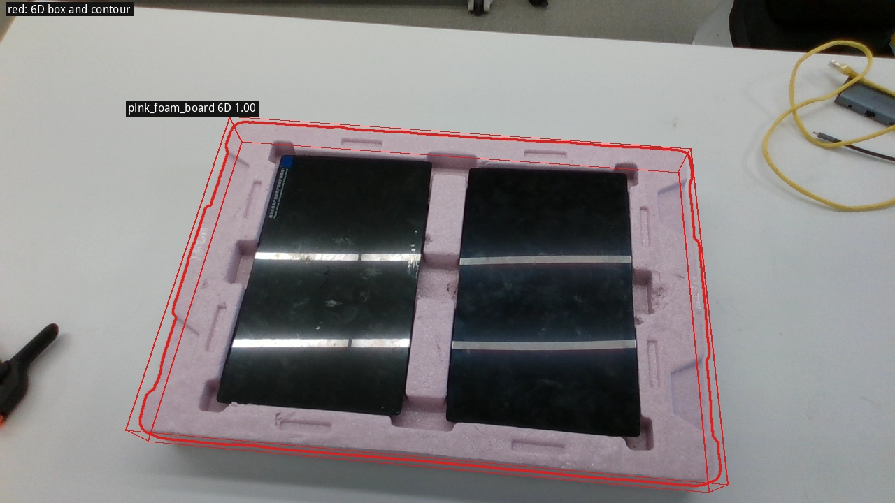
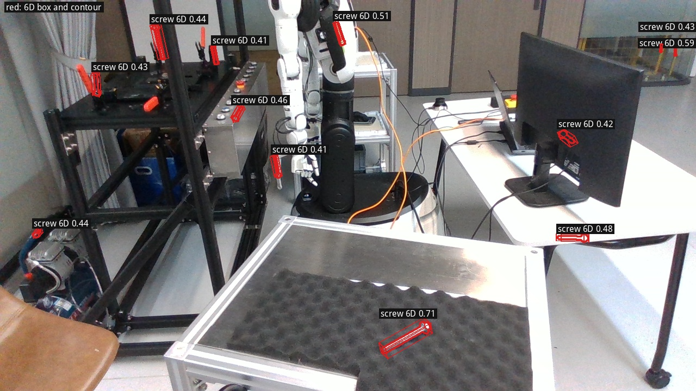

最近，我在做 WAPR 的复现与验证。它是一种面向未见物体的 6D 位姿修正方法：给定图像、深度和物体模型，估计物体相对于相机的位置与朝向。

我希望通过这次实践，弄清楚它怎样接入真实采集的数据，以及从官方示例走向工业场景时，还需要解决哪些问题。实验从环境搭建开始，逐步覆盖了检测分割、位姿估计、多物体跟踪，以及笔记本和 Orin 上的推理测试。

目前，已有三维模型条件下的多条处理流程已经跑通。自采托盘数据能够得到基本合理的投影结果，复杂背景下的误检、重复预测和部分物体的姿态歧义，也在测试中暴露了出来。

## 先理解位姿估计需要什么

6D 位姿包含三维平移和三维旋转。对于后续的机器人操作，知道物体在图像中的位置还不够，还需要知道它在相机坐标系中的空间位置，以及朝向。

WAPR 的思路是从多个粗略的初始位姿出发，按照候选位姿渲染物体模型，再比较渲染结果与真实观测，预测旋转和平移的修正量。经过多轮更新后，由评分模块选择结果。

本次复现采用的默认流程，会建立 12 个初始位姿候选，依次执行三次 WAPR 修正和两次 SAPR 修正，最后使用 WBPS 评分。这里的“未见物体”指目标物体没有参与位姿模型训练；推理时仍然需要提供对应的三维模型、RGB-D 数据、相机内参，以及目标掩码或检测框。方法本身的介绍可以参考 [WAPR 官方仓库](https://github.com/WangYuLin-SEU/WAPR)。

## 在 8 GB 显存上跑通流程

我的笔记本实验环境是 Ubuntu 22.04，显卡为 RTX 4060 Laptop GPU，显存 8 GB。安装依赖、下载预训练权重并构建 TensorRT 引擎后，我先用官方数据检查各个模块。

显存限制很快影响了配置选择。在部分多物体实验中，我把检测前端换成较小的 DINOv2 ViT-S/14 和 GroundingDINO Swin-T，并在需要时使用 PyTorch 后端。不同实验实际采用的后端并不完全相同，因此我在记录耗时时，也保留了模型配置、输入条件和计时范围。

这个阶段主要解决流程是否可运行的问题：检测框和掩码能否生成，位姿矩阵能否输出，模型投影能否落到对应物体附近。单帧 RGB-D 重建实验则受显存不足影响，还没有完成验证。

## 把 RealSense 自采数据接进来

跑通官方样例后，我开始测试自己采集的泡沫托盘数据。输入图像分辨率为 1280 × 720，深度对齐到 RGB，原始深度值乘以 0.001 转换为米，并提供相机内参和对应的托盘三维模型。

接入时需要特别检查图像、深度、掩码和模型之间的对应关系。目标掩码要覆盖正确区域，深度与彩色图需要对齐，模型尺度和深度也要使用一致的单位，否则后面的位姿修正很难得到可信结果。

在读取已有目标掩码的单物体实验中，程序成功输出了托盘的位姿矩阵。模型投影与托盘外边缘大致对齐，但右侧边缘仍有偏差。这次使用 TensorRT，预热后的位姿估计耗时约为 **86.1 ms**，不包含此前生成掩码的检测分割时间。

<figure>

<figcaption>自采托盘的单物体位姿估计结果。红色轮廓用于检查投影对齐情况；图中的评分不能直接解释为位姿准确率。</figcaption>
</figure>

这组托盘数据没有真实位姿标注，所以当前能确认的是投影对齐的大致情况，还不能据此报告它的定位准确率。

## 从已知掩码到现场检测

接下来，我让程序根据当前图像现场生成检测框和掩码，再进行位姿估计。

在自采托盘的单类别、单实例实验中，二维筛选后保留了 12 条检测结果，最终通过位姿评分和数量约束选出一个托盘。日志记录的前端处理耗时约为 **0.681 s**，位姿估计约为 **3.422 s**，两阶段及相关筛选合计约为 **4.124 s**。

这次检测端和位姿端均使用 PyTorch，且需要处理多个候选。它与前面读取已有掩码、采用 TensorRT 的单目标测试条件不同，不能把两次耗时差异全部归因于检测前端。两组记录也都没有覆盖完整的初始化、预热和结果保存开销。

这一轮让我更明确地看到候选数量的影响。前端提出的候选越多，后续需要渲染、修正和评分的工作就越多。评估系统速度时，需要把目标区域的获得方式和候选规模一起说明。

## 去掉重复预测后 仍然要面对误检

在不预先指定实例数量的托盘实验中，程序输出了 12 条位姿。其中，多个候选收敛到中央托盘附近，也有一些预测落在工具、线缆和背景区域。

加入基于渲染掩码的重复抑制后，这组托盘预测从 **12 条减少到 7 条**。中央托盘附近的重叠预测有所减少，但部分背景误检仍被保留。这些错误结果与托盘投影的重叠较小，不会因为去重而自动消失；剩下的七条输出也不代表场景里真的有七个托盘。

螺丝场景暴露了更明显的问题：去重后，位姿预测只从 **45 条减少到 44 条**，背景误匹配仍然较多。这个结果说明，除了重复抑制，还需要继续改善目标区域的提取，并验证位姿评分的筛选效果。

<figure>

<figcaption>螺丝场景中的部分预测。背景上仍出现了模型投影，后续需要继续检查前端候选与位姿筛选。</figcaption>
</figure>

## 检查精度时 把位置与朝向分开看

后续测试扩展到了多种真实物体和仿真数据。在已有掩码和三维模型的条件下，笔记本上多数物体的位姿阶段平均耗时约为 0.07～0.08 s。真实数据记录的是相对参考标注的误差，仿真数据则可以对照仿真真值；两者需要分别解读。

测试中，有些结果的位置接近参考值，旋转误差却很大。对于具有对称结构的物体，需要检查预测是否属于外观等价的姿态，同时也要排查上下翻转、坐标系和模型原点等问题。不能仅凭投影轮廓接近，就认为完整位姿正确，也不能把所有大角度误差都归因于对称性。

我也跑了 TACO 样例中的双物体连续跟踪。在这段 30 帧短序列里，盒子与滚轮的投影总体能跟随目标变化。后续 29 帧中，两个目标的批量位姿更新平均约为 59 ms／帧；这个时间不包含解码、绘图和保存，也还不足以说明长时间遮挡下的跟踪表现。

## 在 Orin 上重新看时间开销

Orin 上的初步测试，同样体现了输入条件的重要性。

读取一个已有托盘掩码时，TensorRT 位姿阶段的预热后耗时约为 **0.367 s**。改为现场检测和分割后，一次测试产生了 31 个候选，检测前端约为 **2.582 s**，位姿估计约为 **5.837 s**，含筛选的处理时间约为 **8.535 s**，不包含加载和预热。

这些记录帮助我区分了单目标位姿修正与完整定位流程的开销。继续做边缘部署时，我会重点检查前端耗时、候选数量，以及不同后端配置下的实际表现。

## 接下来继续做什么

接下来，我准备把工作集中到三个方向：建立更贴近工业场景的分割与位姿验证数据；检查误检、漏检与重复输出之间的关系；在一致的输入、后端和计时条件下，继续比较推理耗时与位姿误差。

这次实践已经让我建立起一条从数据采集、目标区域提取，到位姿修正和结果检查的实验路径。接下来每一次修改，我都希望能够回答一个具体问题：它改善了哪一类失败，又在什么条件下仍然无效。

